<a href="https://brunamarschner.github.io/"></a>

  &nbsp;
  &nbsp;
  

 


- 📊 **Data & Analysis na SAP** — time MCC COO (internacional): engenharia, análise e ciência de dados, de tabelas a dashboards
- 📱 **iOS Developer & Product Owner** — apps para iPhone, Apple Watch e Vision Pro
- 🎓 **Ciência de Dados e IA na PUCRS** — conclusão em dez/2026, com disciplinas de pós-graduação em Deep Learning, Big Data e Cloud
- 🏆 Pesquisa premiada em feiras científicas na **China, Sérvia e Brasil**

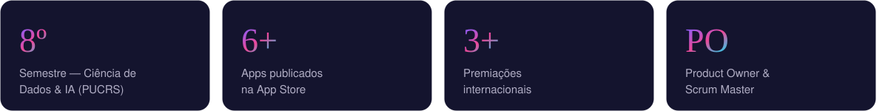

  


  <a href="https://apps.apple.com/us/app/vital-cpr/id6796174209">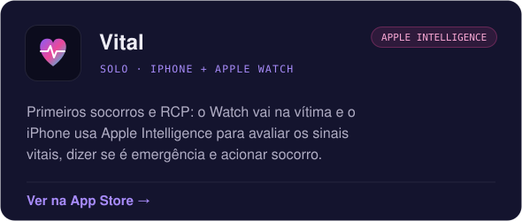</a>
  <a href="https://apps.apple.com/us/app/portal-runes/id6797600759">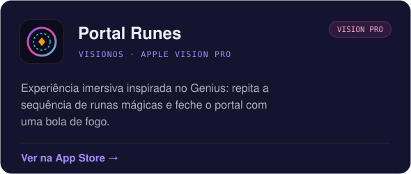</a>

  <a href="https://apps.apple.com/br/app/lens/id6756274876">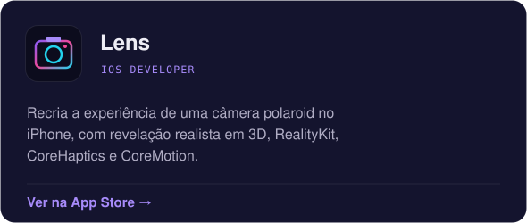</a>
  <a href="https://apps.apple.com/br/app/rise-of-the-lich-king/id6760662821">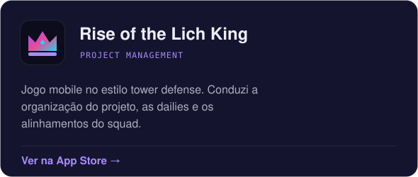</a>

  <a href="https://apps.apple.com/br/app/profitto/id6752310169">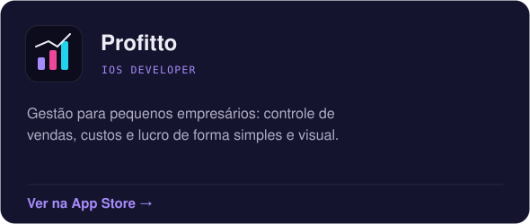</a>
  <a href="https://apps.apple.com/br/app/food-swap/id6747597054">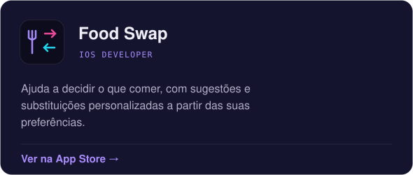</a>

 


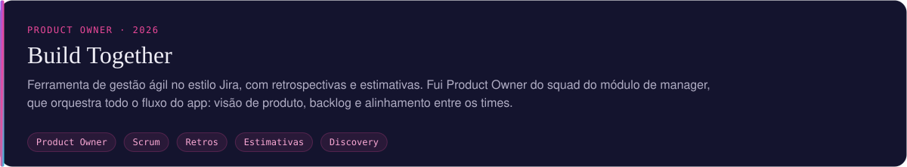

  


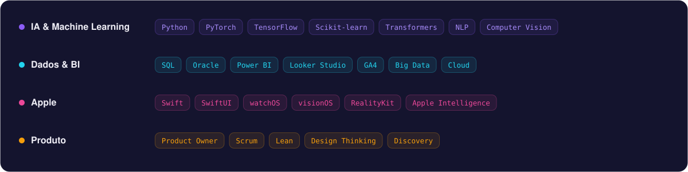

  

  

 


Aberta a oportunidades em **Data Science, IA e Produto**. Me chama em **bruna.marschner@hotmail.com** ou no [LinkedIn](https://linkedin.com/in/brunamarschner) · veja mais no [portfólio](https://brunamarschner.github.io/).
